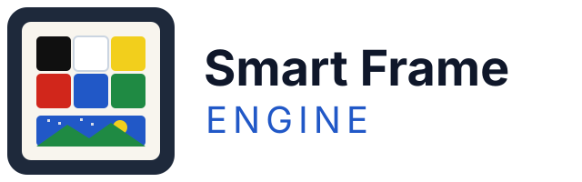
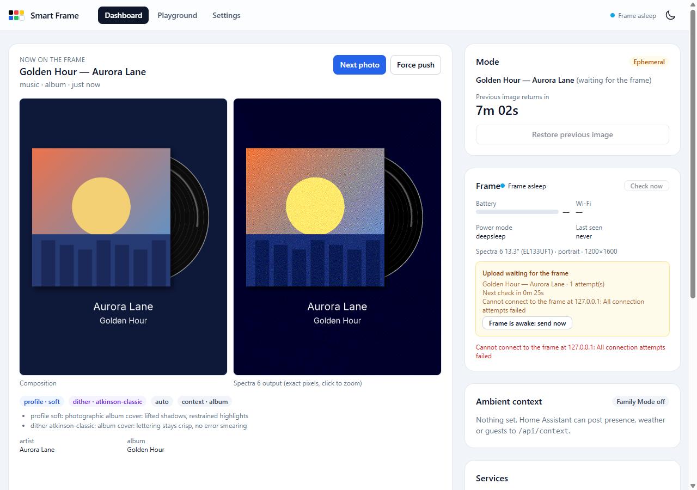
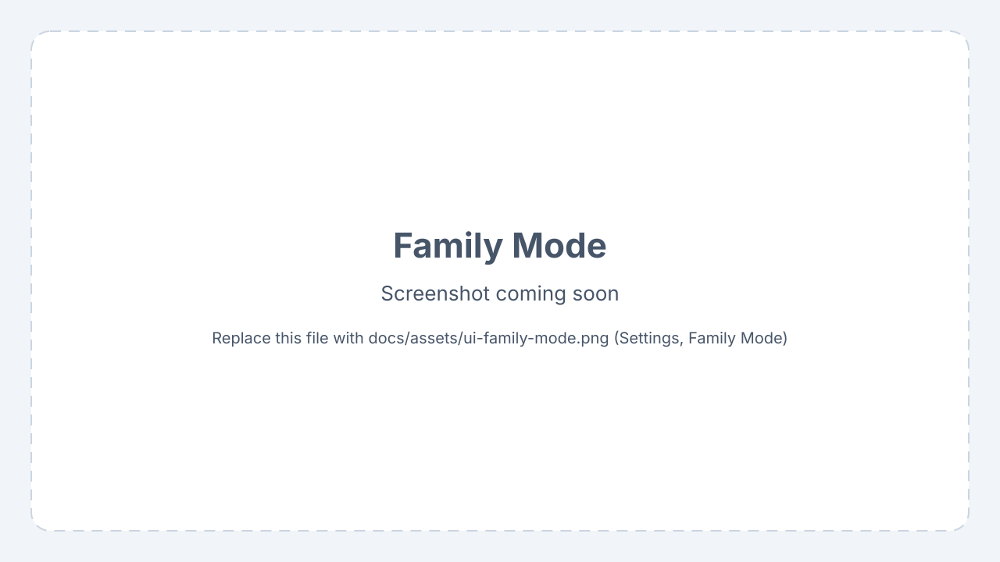
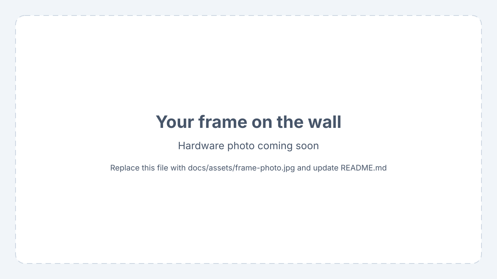

<p align="center">
  
</p>

<p align="center">
  <a href="https://github.com/ant1fr/Smart-Frame-Engine/actions/workflows/ci.yml"></a>
  <a href="https://github.com/ant1fr/Smart-Frame-Engine/pkgs/container/smart-frame-engine"></a>
  <a href="https://github.com/ant1fr/Smart-Frame-Engine/releases/latest"></a>
  <a href="LICENSE"></a>
</p>

<h3 align="center">Your best photos, movie posters and album covers on a color e-ink frame, automatically.</h3>

---

## What is it?

A **Fraimic** frame uses a *Spectra 6* e-ink panel: paper-like, no glare, no backlight, zero power
while it shows a picture. But the panel only has **six colors** (black, white, yellow, red, blue,
green), so a photo sent as-is looks muddy.

**Smart Frame Engine** is the missing piece. It runs quietly on your home server, picks pictures
for you, prepares them so they look their best on those six colors, and sends them to the frame:

- 📸 **Your Immich photos**, chosen for you: favorite people, albums, "on this day"... with a
  quality filter that skips screenshots, blurry shots, documents and blank frames.
- 🎬 **Movie and TV posters** in HD (from TMDB) when you start a film, shown whole, never cropped.
- 🎵 **Album covers** for the music that is playing, with the artist and album underneath.
- 🧠 **A smarter eInk pipeline**: it chooses the right color profile and dithering per picture, so
  skin tones, skies and album art all look right.
- 🏠 **Home Assistant friendly**: show the right thing when you press play, when guests arrive, or
  when it rains. Or ignore Home Assistant entirely: it also works on its own, on a timer.
- 🔒 **Yours alone**: self-hosted, no cloud, optional password. Private albums and the Immich
  Locked Folder never appear on the wall.

<p align="center">
  
</p>

## Get it running in 3 minutes

You need Docker and the address of your frame. (Immich and TMDB are optional and can be added
later, in the web UI.)

```bash
mkdir smart-frame && cd smart-frame
curl -fsSLO https://raw.githubusercontent.com/ant1fr/Smart-Frame-Engine/main/docker-compose.yml
curl -fsSL  https://raw.githubusercontent.com/ant1fr/Smart-Frame-Engine/main/.env.example -o .env
docker compose up -d
```

1. Open **http://localhost:8080** (or `http://<your-server>:8080`).
2. *Settings → Frame*: enter the frame's IP address (give it a fixed IP on your router).
3. *Settings → Immich*: add your server and API key, tick the people or albums you like.
4. Press **Next photo** on the dashboard. 🎉

Want it to refresh by itself? Turn on the scheduler in *Settings → Frame & schedule*.

> **Using a NAS or Portainer?** Set `DATA_DIR` (a host folder), `HOST_PORT`, `PUID` and `PGID`
> in `.env` or in the stack variables. Step-by-step guides are in the
> [wiki](https://github.com/ant1fr/Smart-Frame-Engine/wiki/Installation-and-Deployment).
> Building from source: `docker compose -f docker-compose.build.yml up -d --build`.

## A quick tour

<table>
  <tr>
    <td width="50%"><br><b>Playground</b>: try posters, album covers and title cards, and compare Spectra 6 renderings side by side before anything reaches the frame.</td>
    <td width="50%"><br><b>Family Mode</b>: show only your family, hide private people and albums, and let Home Assistant switch it on when guests are over.</td>
  </tr>
</table>

<p align="center">
  <br>
  <sub>Your frame, on the wall. (A real photo is coming.)</sub>
</p>

- **Smart Mix**: a weighted playlist ("60% family, 25% travel, 15% movie posters") for
  scheduled refreshes, plus **Random Discovery** that occasionally digs up a forgotten photo.
- **Ambient context**: Home Assistant can say who is home, the weather or the season; the engine
  leans the playlist that way for a while, then forgets on its own.
- **Battery frames**: in deep-sleep mode, new pictures wait in a queue and are delivered the
  moment the frame wakes up.
- **Temporary pictures**: a poster or album cover shows for the length of the film or song,
  then your slideshow comes back.

## Learn more

The full documentation lives in the **[GitHub Wiki](https://github.com/ant1fr/Smart-Frame-Engine/wiki)**:

| | |
| --- | --- |
| [Installation and Deployment](https://github.com/ant1fr/Smart-Frame-Engine/wiki/Installation-and-Deployment) | Docker, Synology, Portainer, reverse proxy, host networking |
| [Configuration Reference](https://github.com/ant1fr/Smart-Frame-Engine/wiki/Configuration-Reference) | Every setting, Smart Mix, Family Mode, Spectra 6 dithering |
| [Immich and TMDB Setup](https://github.com/ant1fr/Smart-Frame-Engine/wiki/Immich-and-TMDB-Setup) | API keys, pickers, the Locked Folder rule |
| [API Reference](https://github.com/ant1fr/Smart-Frame-Engine/wiki/API-Reference) | Authentication and every endpoint (also live at `/docs`) |
| [Home Assistant Integration](https://github.com/ant1fr/Smart-Frame-Engine/wiki/Home-Assistant-Integration) | Automations, discovery |

## Feedback, issues & roadmap

This is a young project and it gets better with your help. 💙

- 🐛 **Found a bug?** [Open an issue](https://github.com/ant1fr/Smart-Frame-Engine/issues/new/choose): the template asks only for what helps.
- 💡 **Have an idea or a new image source in mind?** Open a feature request, or start a
  [discussion](https://github.com/ant1fr/Smart-Frame-Engine/discussions).
- 🗺️ **Curious what is next?** Read the [roadmap](ROADMAP.md): editorial templates (quotes,
  weather, agenda, collages), more engines and generative art are on the way.
- 🛠️ **Want to contribute?** See [CONTRIBUTING.md](CONTRIBUTING.md). Small fixes are welcome too.
- 🔐 **Security issue?** Please report it privately: see [SECURITY.md](SECURITY.md).

Show me your wall: a photo of your frame in the discussions makes my day.

## Credits

The Spectra 6 palette, color metric, Atkinson kernel and `.bin` layouts follow the official
[Fraimic Bin Converter](https://github.com/Fraimic/fraimic_bin_converter) (MIT), which builds on
Toon-nooT's [PhotoPainter Spectra 6 converter](https://github.com/Toon-nooT/PhotoPainter-E-Ink-Spectra-6-image-converter).
The `soft` / `vivid` curves and dithering kernels are adapted from the MIT-licensed
[Stillroom](https://github.com/WillCroPoint/stillroom) converter by WillCroPoint (not a Fraimic project).
Templates use the [Inter](https://github.com/rsms/inter) typeface (SIL OFL 1.1).

This product uses the TMDB API but is not endorsed or certified by [TMDB](https://www.themoviedb.org).
Album covers come from the [Deezer API](https://developers.deezer.com),
[MusicBrainz](https://musicbrainz.org) and the [Cover Art Archive](https://coverartarchive.org).
Not affiliated with Fraimic or Immich.

## License

[MIT](LICENSE)
